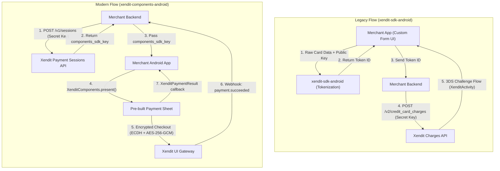

# Migration Guide: `xendit-sdk-android` to `xendit-components-android`

This guide helps you migrate your Android application from the legacy Xendit Android SDK ([`xendit-sdk-android`](https://github.com/xendit/xendit-sdk-android) / `com.xendit:xendit-android`) to the modern **Xendit Components Android SDK** ([`xendit-components-android`](https://github.com/xendit/xendit-components-android) / `co.xendit:components`).

---

## Table of Contents
1. [Why Migrate to Components SDK?](#why-migrate-to-components-sdk)
2. [Key Architecture Differences](#key-architecture-differences)
3. [Prerequisites & Requirements](#prerequisites--requirements)
4. [Step-by-Step Migration](#step-by-step-migration)
   - [Step 1: Backend Session Creation](#step-1-backend-session-creation)
   - [Step 2: Update Gradle Dependencies](#step-2-update-gradle-dependencies)
   - [Step 3: Clean Up AndroidManifest](#step-3-clean-up-androidmanifest)
   - [Step 4: Update SDK Initialization](#step-4-update-sdk-initialization)
   - [Step 5: Replace Payment UI & Tokenization Call](#step-5-replace-payment-ui--tokenization-call)
   - [Step 6: Appearance & Theming (Optional)](#step-6-appearance--theming-optional)
   - [Step 7: Payment Method Filtering (Optional)](#step-7-payment-method-filtering-optional)
5. [Side-by-Side Code Comparison](#side-by-side-code-comparison)
   - [Kotlin](#kotlin-comparison)
   - [Java](#java-comparison)
6. [Google Pay Production Checklist](#google-pay-production-checklist)
7. [FAQ & Troubleshooting](#faq--troubleshooting)

---

## Why Migrate to Components SDK?

| Capability | Legacy SDK (`xendit-sdk-android`) | New SDK (`xendit-components-android`) |
| :--- | :--- | :--- |
| **Payment Channels** | Credit/Debit Cards only | Cards, E-Wallets (ShopeePay, OVO, Dana), QRIS, Google Pay |
| **User Interface** | None — Merchant builds custom UI forms | Drop-in bottom sheet with native Jetpack Compose & Material 3 |
| **Security Credential** | Static `publishableKey` in mobile client | Ephemeral, session-scoped `components_sdk_key` |
| **Data Encryption** | Standard HTTPS / Basic Tokenization | Client-side **ECDH + AES-256-GCM** payload encryption |
| **3DS & Redirects** | Manual `XenditActivity` configuration | Automated in-sheet WebView & deep-link routing |
| **PCI-DSS Scope** | Typically **SAQ A-EP** (you host input fields) | Reduced to **SAQ A** (Xendit manages input fields) |

---

## Key Architecture Differences



---

## Prerequisites & Requirements

| Requirement | Legacy SDK | Components SDK |
| :--- | :--- | :--- |
| **Minimum Android Version** | Android 5.0 (API 21) | **Android 8.0 (API 26)** |
| **Target / Compile SDK** | 31+ | **37** |
| **Kotlin Version** | 1.6+ | **2.4+** |
| **Jetpack Compose BOM** | N/A | **2026.05.01+** |

---

## Step-by-Step Migration

### Step 1: Backend Session Creation

The legacy SDK used a client-side public API key to generate tokens. The modern Components SDK uses an **ephemeral session key** (`components_sdk_key`) created by your backend.

1. On your backend, create a session via the [Xendit Payment Sessions API](https://developers.xendit.co):
   ```http
   POST https://api.xendit.co/sessions
   Authorization: Basic <BASE64_ENCODED_SECRET_KEY>
   Content-Type: application/json

   {
     "reference_id": "order-12345",
     "currency": "IDR",
     "amount": 100000,
     "customer": {
       "reference_id": "cust-001",
       "given_names": "Alex"
     }
   }
   ```
2. Retrieve the `components_sdk_key` from the response and pass it to your Android app:
   ```json
   {
     "id": "sess_12345",
     "components_sdk_key": "xnd_components_live_...",
     "status": "ACTIVE"
   }
   ```

---

### Step 2: Update Gradle Dependencies

1. Remove the legacy `xendit-android` dependency from your app's `build.gradle` or `build.gradle.kts`.
2. Add the `xendit-components-android` dependency (`co.xendit:components:<latest_version>`).

#### Gradle (Kotlin DSL)
```kotlin
// build.gradle.kts (App level)
dependencies {
    // REMOVE: implementation("com.xendit:xendit-android:4.2.5")
    
    // ADD:
    implementation("co.xendit:components:<latest_version>")
}
```

#### Gradle (Groovy DSL)
```groovy
// build.gradle (App level)
dependencies {
    // REMOVE: implementation 'com.xendit:xendit-android:4.2.5'
    
    // ADD:
    implementation 'co.xendit:components:<latest_version>'
}
```

Ensure Maven Central is present in your `settings.gradle.kts` / `settings.gradle`:
```kotlin
dependencyResolutionManagement {
    repositories {
        google()
        mavenCentral()
    }
}
```

---

### Step 3: Clean Up AndroidManifest

In the legacy SDK, `XenditActivity` had to be registered in your `AndroidManifest.xml` to handle 3DS flows. **Remove this entry**:

```xml
<!-- In AndroidManifest.xml: REMOVE THIS -->
<activity android:name="com.xendit.XenditActivity"/>
```

The Components SDK handles all 3DS flows and redirects within the payment sheet automatically.

---

### Step 4: Update SDK Initialization

#### Legacy (`xendit-sdk-android`)
In the legacy SDK, you instantiated a `Xendit` object passing your publishable key:
```java
// Legacy
Xendit xendit = new Xendit(context, "xnd_public_development_...", currentActivity);
```

#### Modern (`xendit-components-android`)
Initialize `XenditComponents` once during application or activity startup. No API keys are passed to the client during initialization:

```kotlin
// Kotlin
import co.xendit.components.XenditComponents
import co.xendit.components.ui.style.XenditAppearance

XenditComponents.initialize(appearance = XenditAppearance())
```

```java
// Java
import co.xendit.components.XenditComponents;
import co.xendit.components.ui.style.XenditAppearance;

XenditComponents.INSTANCE.initialize(new XenditAppearance(), null);
```

---

### Step 5: Replace Payment UI & Tokenization Call

In the legacy SDK, you built custom text inputs for the card number, expiry, and CVN, called `xendit.createSingleUseToken(...)`, and sent the resulting token ID to your backend.

With Components SDK:
1. **Remove** custom card input forms, expiry inputs, and CVV fields.
2. Call `XenditComponents.present(...)` from any `ComponentActivity`, passing the `components_sdk_key`.
3. Handle the payment result callback.

```kotlin
// Kotlin
import co.xendit.components.XenditComponents
import co.xendit.components.data.model.XenditPaymentResult

XenditComponents.present(
    activity = this, // ComponentActivity
    componentsSdkKey = componentsSdkKeyFromBackend
) { result ->
    when (result) {
        is XenditPaymentResult.Success -> {
            println("Payment successful! Request ID: ${result.paymentRequestId}")
            // Notify your backend or navigate to order success screen
        }
        is XenditPaymentResult.Failed -> {
            println("Payment failed: ${result.error.message}")
        }
        is XenditPaymentResult.Canceled -> {
            println("Session canceled by user or backend")
        }
        is XenditPaymentResult.Expired -> {
            println("Payment session expired")
        }
        is XenditPaymentResult.Dismissed -> {
            println("User dismissed the payment sheet")
        }
    }
}
```

---

### Step 6: Appearance & Theming (Optional)

You can customize the payment sheet to match your brand colors, typography, and corner radius using `XenditAppearance`:

```kotlin
import androidx.compose.ui.graphics.Color
import androidx.compose.ui.unit.dp
import co.xendit.components.XenditComponents
import co.xendit.components.ui.style.XenditAppearance

val customAppearance = XenditAppearance(
    colorPrimary = Color(0xFF0052FF),
    colorText = Color(0xFF1A1C1E),
    colorBackground = Color(0xFFFFFFFF),
    borderRadius = 12.dp,
    isLightStatusBars = true
)

XenditComponents.initialize(appearance = customAppearance)
```

---

### Step 7: Payment Method Filtering (Optional)

Merchants can specify which payment methods are shown in the payment sheet:

```kotlin
import co.xendit.components.XenditComponents
import co.xendit.components.XenditComponentsPaymentType

// Initialize with preferred methods:
XenditComponents.initialize(
    appearance = XenditAppearance(),
    merchantPreferredPaymentMethod = listOf(
        XenditComponentsPaymentType.CARDS,
        XenditComponentsPaymentType.EWALLET,
        XenditComponentsPaymentType.QR_CODE
    )
)

// Or override dynamically on a specific present() call:
XenditComponents.present(
    activity = this,
    componentsSdkKey = "<components_sdk_key>",
    merchantPreferredPaymentMethod = listOf(XenditComponentsPaymentType.QR_CODE)
) { result ->
    // handle result
}
```

---

## Side-by-Side Code Comparison

### Kotlin Comparison

#### Legacy (`xendit-sdk-android`)
```kotlin
// Legacy: Manual form validation + tokenization
val card = Card(
    cardNumber = "4000000000000002",
    cardExpMonth = "12",
    cardExpYear = "2027",
    cardCvn = "123"
)

val xendit = Xendit(applicationContext, "xnd_public_development_...", this)
xendit.createSingleUseToken(card, "100000", true, object : TokenCallback() {
    override fun onSuccess(token: Token) {
        val tokenId = token.id
        // Send tokenId to your backend to charge with /v2/credit_card_charges
    }

    override fun onError(error: XenditError) {
        showError(error.message)
    }
})
```

#### New (`xendit-components-android`)
```kotlin
// Modern: Complete drop-in payment sheet
XenditComponents.initialize(appearance = XenditAppearance())

XenditComponents.present(
    activity = this,
    componentsSdkKey = "<components_sdk_key>"
) { result ->
    when (result) {
        is XenditPaymentResult.Success -> {
            // Payment complete! Charge captured directly by Xendit
            showSuccess(result.paymentRequestId)
        }
        is XenditPaymentResult.Failed -> {
            showError(result.error.message)
        }
        is XenditPaymentResult.Canceled,
        is XenditPaymentResult.Expired,
        is XenditPaymentResult.Dismissed -> {
            // Handle dismissal or cancellation
        }
    }
}
```

---

### Java Comparison

#### Legacy (`xendit-sdk-android`)
```java
// Legacy: Custom input fields + manual tokenization
Card card = new Card(cardNumber, expMonth, expYear, cvn);
Xendit xendit = new Xendit(getApplicationContext(), "xnd_public_development_...", this);

xendit.createSingleUseToken(card, "100000", true, new TokenCallback() {
    @Override
    public void onSuccess(Token token) {
        sendTokenToBackend(token.getId());
    }

    @Override
    public void onError(XenditError error) {
        showError(error.getMessage());
    }
});
```

#### New (`xendit-components-android`)
```java
// Modern: Pre-built payment sheet
XenditComponents.INSTANCE.initialize(new XenditAppearance(), null);

XenditComponents.INSTANCE.present(
    this,
    "<components_sdk_key>",
    null,
    result -> {
        if (result instanceof XenditPaymentResult.Success) {
            XenditPaymentResult.Success success = (XenditPaymentResult.Success) result;
            System.out.println("Paid: " + success.getPaymentRequestId());
        } else if (result instanceof XenditPaymentResult.Failed) {
            XenditPaymentResult.Failed failed = (XenditPaymentResult.Failed) result;
            System.out.println("Error: " + failed.getError().getMessage());
        }
    }
);
```

---

## Google Pay Production Checklist

When Google Pay is enabled in your session, the Components SDK automatically displays the native Google Pay option in the payment sheet.

> [!IMPORTANT]
> **Production App Registration Required:**
> Before offering Google Pay in production, you must register and approve your Android app package name in the **[Google Pay & Wallet Console](https://pay.google.com/business/console/)**.
> If your application is not approved for production access, Google Pay transactions will fail with error `OR_BIBED_11`.

---

## FAQ & Troubleshooting

### 1. Where do I get the `components_sdk_key`?
The `components_sdk_key` is generated whenever your backend calls the [Xendit Payment Sessions API](https://docs.xendit.co/docs/components-overview) (`POST /v1/sessions` or `/sessions`). It replaces the static publishable key used in the legacy SDK.

### 2. Can I still charge tokens manually on my backend?
With Components SDK, payment authorization and capture happen within the payment sheet flow. Your backend is notified of payment status via webhooks (`payment.succeeded`, `payment.failed`, `payment_session.completed`).

### 3. Does the Components SDK support Java projects?
Yes. The SDK is fully interoperable with Java through `XenditComponents.INSTANCE`. Your calling Activity must be a `ComponentActivity` (or `AppCompatActivity` / `FragmentActivity`).

### 4. What happens if a customer dismisses the payment sheet?
The callback returns `XenditPaymentResult.Dismissed`. You can allow the customer to retry, change items in their cart, or select another flow.

### 5. Where can I find more sample code?
Check out the [example-app/](example-app/) directory in this repository for a complete Jetpack Compose implementation.
